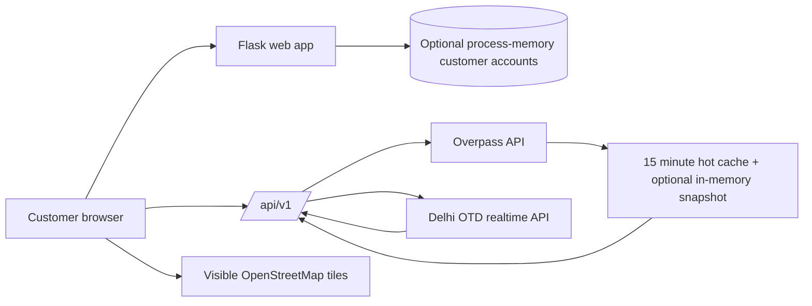

# Architecture

## Current system

The app is a Flask service with server-rendered landing, login, registration, and customer dashboard pages plus a same-origin JSON API. Customer credentials are stored in SQLite for local development and in the Flask app's process memory when `CUSTOMER_STORAGE=memory`; passwords are Werkzeug hashes and signed Flask sessions carry only the customer id. Memory-backed accounts disappear when the process ends and are not shared between worker processes. Customer authentication protects `/dashboard`; read-only transit APIs remain public. The browser renders an interactive Leaflet map with OpenStreetMap tiles. Flask queries the public Overpass API for Delhi-area bus-stop nodes and mapped bus-route relations. Local development persists successful source snapshots in SQLite at `instance/transit-cache.sqlite3`. With `TRANSIT_CACHE_BACKEND=memory`, snapshots live in a bounded 32 MiB process cache and disappear on restart. OSM data is fresh for 15 minutes and can be served stale for up to seven days while a background refresh runs if a snapshot remains in cache. OTD positions are fresh for 15 seconds and a non-empty snapshot can be served stale for up to ten minutes. No transit records are seeded.

## Data boundaries

- `transit/osm.py` owns the Delhi bounding box, Overpass query, in-process cache, and normalization of stops/routes into the dashboard contract.
- `transit/vehicles.py` owns the optional authenticated OTD realtime request and GTFS-Realtime parsing. It returns an explicit `key_required` state if no key is configured.
- `transit/cache.py` owns source snapshots. Local development defaults to SQLite; configure `TRANSIT_CACHE_BACKEND=memory` for an in-process, size-limited cache.
- `transit/routes.py` maps source results to `/api/v1/transit` and `/api/v1/vehicles`.
- `templates/index.html` and `static/` implement source labels, map, route/stop lists, live vehicle search/filter/pagination, accessible vehicle details, and CSV export.
- OSM describes mapped transit infrastructure, not actual operating schedules or vehicle movement. OSM coverage can be partial. OTD is a separate official source and requires access approval for live positions.

## Limits and production direction

The free deployment uses no external database or storage service. Customer registrations and cached snapshots disappear when the process restarts or sleeps, and process memory is not shared across multiple instances. Do not increase public Overpass polling or scrape map tiles. OSM community endpoints and the standard tile service are best-effort and do not provide a service-level agreement.

For live operations, use the official operator feed where approved, retain source timestamps and feed age, and make stale/unavailable states visible. Add identity, roles, audit history, provider monitoring, and reviewed data retention before any dispatch workflow. Keep an adapter boundary so a city's feed can be changed without coupling source-specific fields to the UI.
